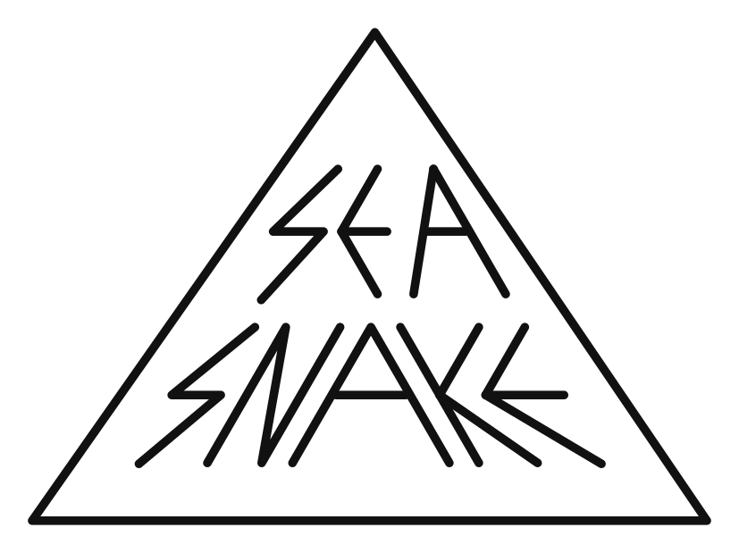
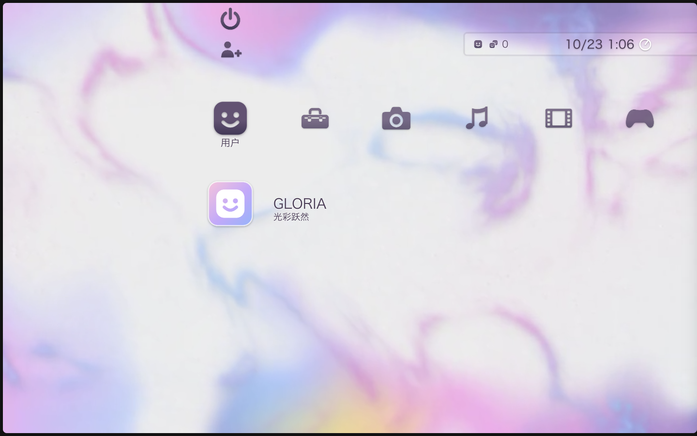
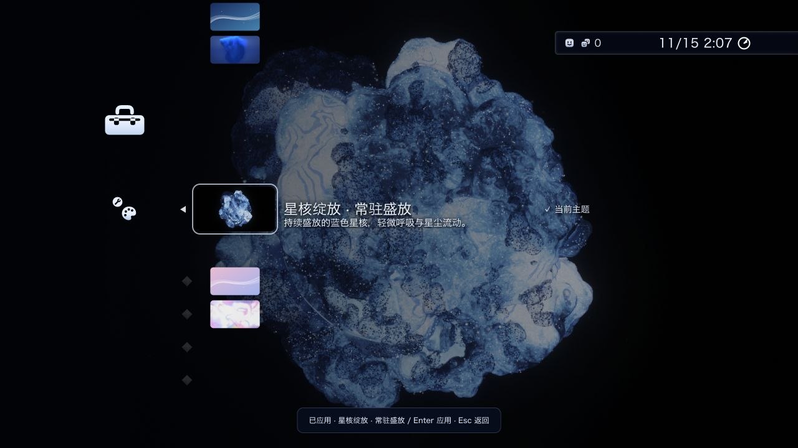
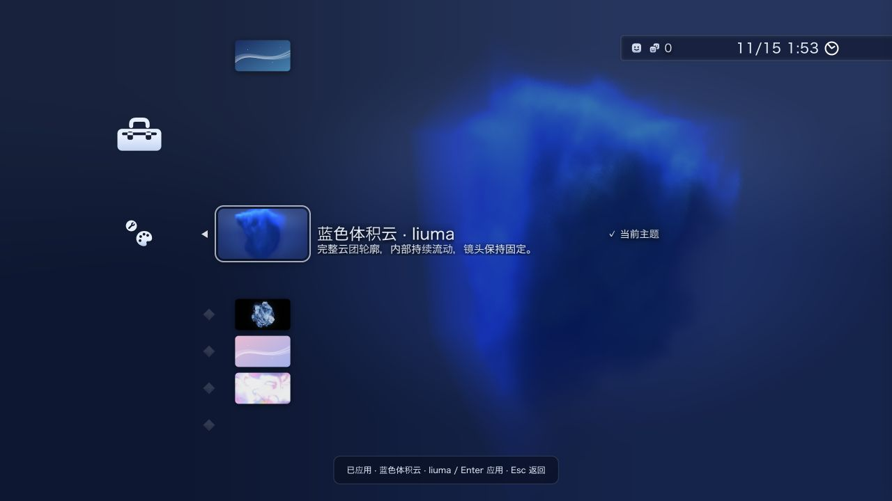
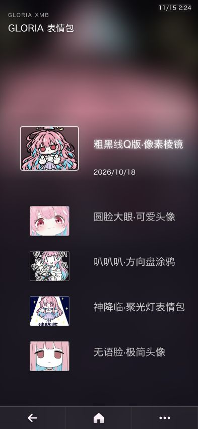
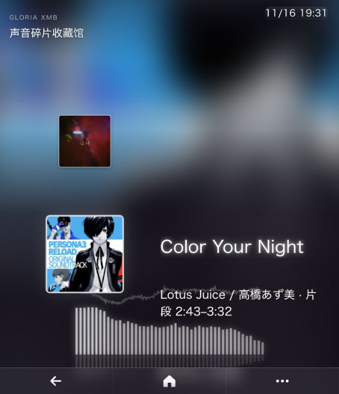

<div align="center">

<a href="https://www.bilibili.com/toy/gloria-xmb/index.html"></a>

# GLORIA XMB

**A browser-based XMB-style personal launcher for my GLORIA illustrations, short clips, Bilibili uploads and music.**<br>
<sub>次世代 B 站启动器 · 光彩跃然 · v2.1.0 · 中文用户请看 <a href="README.zh-CN.md">简体中文说明</a></sub>

<a href="https://www.bilibili.com/toy/gloria-xmb/index.html"></a>
<a href="README.zh-CN.md"></a>
<a href="CHANGELOG.md"></a>

<a href="https://github.com/seasnakes/gloria-xmb/stargazers"></a>
<a href="https://x.com/snakeseas"></a>
<a href="https://space.bilibili.com/486682682"></a>
<a href="https://www.zhihu.com/people/SeASnAkE"></a>

</div>

<a href="https://www.bilibili.com/toy/gloria-xmb/index.html"></a>

## What this is

GLORIA XMB is a personal creative launcher built in the browser around a classic XrossMediaBar (XMB) menu, live on [Bilibili Toy](https://www.bilibili.com/toy/gloria-xmb/index.html).

I put it together as one place to browse work around my original character **GLORIA** (光彩跃然): character art with prompts, short multiverse video clips, my Bilibili uploads, favorite music excerpts and links to other web toys I've made.

The interface runs in Simplified Chinese and English (`Settings → System Settings → System Language`). It is a web interface replica and personal portfolio—not a real operating system, and not an official PlayStation or Sony product.

## Live themes

<table><tr>
<td width="50%" valign="top"><a href="https://www.bilibili.com/toy/gloria-xmb/index.html"></a><br><b>Stellar Bloom · Ambient</b> · 星核绽放<br><sub>Stays in full bloom with drifting stardust and slow surface detail, without collapsing back to replay.</sub></td>
<td width="50%" valign="top"><a href="https://www.bilibili.com/toy/gloria-xmb/index.html"></a><br><b>Blue Volume · liuma</b> · 蓝色体积云<br><sub>Frames the full cloud silhouette while internal density and light keep flowing under a fixed camera.</sub></td>
</tr></table>

Open `Settings → Theme Settings → Themes` (`设定 → 主题设定 → 主题`) to switch backgrounds:

- **Cotton Candy · GLORIA** (`棉花糖 · 光彩跃然`, shown at the top) is the default pastel fluid loop, adjusting its brightness across dawn, day, dusk and night.
- **Stellar Bloom · Ambient** (`星核绽放 · 常驻盛放`) holds an open blue stellar core with continuous detail motion and stardust instead of snapping shut at the end of a loop.
- **Blue Volume · liuma** (`蓝色体积云 · liuma`) renders a real-time volumetric cloud with its full outline in view, flowing clouds inside and a non-rotating camera.
- Classic wave and palette themes (**Original** with monthly colors, plus **GLORIA**) are also built in.

Pausing on a theme cover previews the live background. Confirming saves the choice and takes you straight back to the home screen; backing out cancels the preview and restores your saved theme.

Animated backgrounds pause automatically when the browser tab is hidden or when a media viewer or item preview is open. They respect `prefers-reduced-motion` and fall back to a static background if WebGL2 fails or isn't supported. Real-time shader themes still depend on the device GPU, so smoothness varies across hardware.

## Photos, videos and sound fragments

<table><tr>
<td width="50%" valign="top"><div align="center"><a href="https://www.bilibili.com/toy/gloria-xmb/index.html"></a></div><br><b>GLORIA Photos & Prompts</b> · 照片与提示词<br><sub>6 expression stickers (including a looping GIF) and 7 style illustrations, each paired with its prompt.</sub></td>
<td width="50%" valign="top"><div align="center"><a href="https://www.bilibili.com/toy/gloria-xmb/index.html"></a></div><br><b>Sound Fragment Collection</b> · 声音碎片收藏馆<br><sub>Short playable excerpts inside the launcher, including a 49-second cut of <i>Color Your Night</i> (2:43–3:32).</sub></td>
</tr></table>

- **Photo** (`照片`): 13 curated GLORIA works split into **GLORIA Expressions** (6 reaction pieces, including a looping sway GIF) and **GLORIA Styles** (7 illustrations). Open any image to read or copy its generation prompt, or start a slideshow.
- **Game** (`游戏`): 10 eight-second video shorts where GLORIA travels across game worlds (*Don't Starve*, *Tomodachi Life*, *Detroit: Become Human*, *Persona 5*, *Undertale*, *Danganronpa*, *Minecraft*, *Monument Valley*, *Gravity Rush* and *Metal Gear Solid*). Pausing on an icon plays a preview; confirming plays the clip. These are short animated videos rather than playable games. Earlier interactive web toys live under `Network → Creative Tools` (`网络 → 创作工具`).
- **Video** (`视频`): **My Uploads** (`我的投稿`) holds 25 publicly readable Bilibili videos from the *Opus 5.5 one-sentence `world.execute(me);` MV* episode onward, playable in an embedded frame or on Bilibili.
- **Music** (`音乐`): alongside the *GLORIA* NetEase playlist, **Sound Fragment Collection** (`声音碎片收藏馆`) currently includes *宿醉* (*Hangover*) and *Color Your Night* (a 49-second excerpt from `2:43–3:32` of the original song, with a live bar visualizer). Streamed playlist tracks and external videos depend on NetEase Cloud Music and Bilibili availability; entries without direct outer playback open on the source platform.

## Controls

- **Keyboard**: Arrow keys (or `W` `A` `S` `D`) move across categories and items, `Enter` / `Space` / `X` confirms, `Esc` / `Backspace` / `O` goes back, and `T` / `I` opens the options menu. In the photo viewer, press `↑` to toggle the prompt panel.
- **Mouse & trackpad**: Click to focus or open, scroll vertically or horizontally to move through menus, and right-click for options.
- **Mobile touch**: Portrait screens open a category home screen. Tap or swipe to navigate, and use the bottom bar for Back, Home and Options.
- **Gamepad**: Standard browser Gamepad mapping works out of the box—D-pad or left stick to navigate, `✕` to confirm, `○` to go back and `△` for options.

## Run it locally

You need Node.js (with `npm`) and Python 3.

```bash
npm ci
```

```bash
npm run build
```

```bash
python3 tools/serve.py
```

Then open http://127.0.0.1:8876/package/ .

`npm run build` runs `build_release.py` to assemble `package/` and `gloria-xmb-cotton-v2.zip`, verifying JavaScript syntax and every referenced media path along the way. `tools/serve.py` serves the repo without browser caching and supports HTTP `Range` requests so audio and video seeks work properly.

Compressed runtime media is tracked in the repo, so building from a clean checkout does not need any raw master videos. Only re-encoding media from scratch requires original source files.

## Editing the source

Edit files under `source/` only—`package/` and `gloria-xmb-cotton-v2.zip` are generated build outputs:

- `source/index.html`, `source/js/`, `source/css/` — XMB layout, input handling, viewers, background audio player and theme lifecycle.
- `source/content/data.js` and `source/plugins/gloria-content.js` — media entries and the plugin that mounts them onto the XMB categories.
- `source/themes/` and `source/plugins/plugins.js` — palette themes, real-time WebGL2 backgrounds (`source/themes/effects/`) and the startup manifest.

Helper scripts under `tools/` for syncing uploads, refreshing playlists and re-encoding media are documented in [docs/MAINTAINING.md](docs/MAINTAINING.md) (in Chinese).

## Changelog

- **v2.1.0 · 2026-11-17** · Added the *Stellar Bloom* and *Blue Volume* real-time themes with cover previews and one-step apply-and-return; curated 13 GLORIA photo works and 25 public Bilibili uploads; renamed the music excerpt folder to *Sound Fragment Collection* and added the 49-second *Color Your Night* clip.

Full release notes are in [CHANGELOG.md](CHANGELOG.md).

## Credits & rights

- **Blue Volume · liuma** is adapted from my Shadertoy shader [liuma test](https://www.shadertoy.com/view/t3sXW8), based on [Volumetric lighting](https://www.shadertoy.com/view/tdjBR1) by tmst. **Stellar Bloom** and **Cotton Candy** come from my own visual sketches. See [`source/themes/effects/CREDITS.txt`](source/themes/effects/CREDITS.txt) for adaptation details.
- The cross-menu interface is a tribute to the classic XMB design. This project is an independent personal web work and is not affiliated with or endorsed by Sony Interactive Entertainment or PlayStation.
- Music tracks, album covers, and the game worlds and characters referenced in the video clips belong to their respective rights holders.
- The **GLORIA** (光彩跃然) character, original illustrations and the SEASNAKE triangle logo are personal assets. This repository does not include an open-source license; the source is public for viewing and reference, without granting redistribution or commercial rights to the code, character assets or third-party media.

## Star history

<a href="https://www.star-history.com/#seasnakes/gloria-xmb&Date">
 <picture>
   <source media="(prefers-color-scheme: dark)" srcset="https://api.star-history.com/svg?repos=seasnakes/gloria-xmb&type=Date&theme=dark" />
   <source media="(prefers-color-scheme: light)" srcset="https://api.star-history.com/svg?repos=seasnakes/gloria-xmb&type=Date" />
   
 </picture>
</a>

<div align="center">
<br>
<sub>by SEASNAKE · <a href="https://x.com/snakeseas">X</a> · <a href="https://space.bilibili.com/486682682">Bilibili</a> · <a href="https://www.zhihu.com/people/SeASnAkE">Zhihu</a> · <a href="README.zh-CN.md">简体中文</a></sub>
</div>
