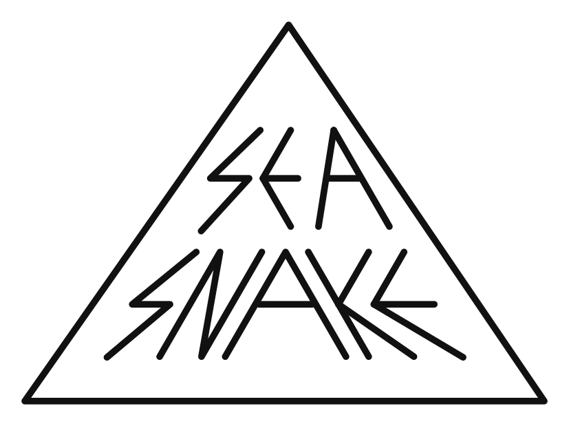
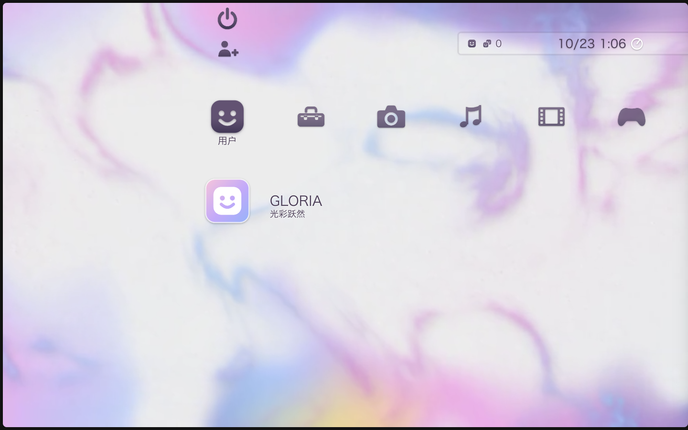
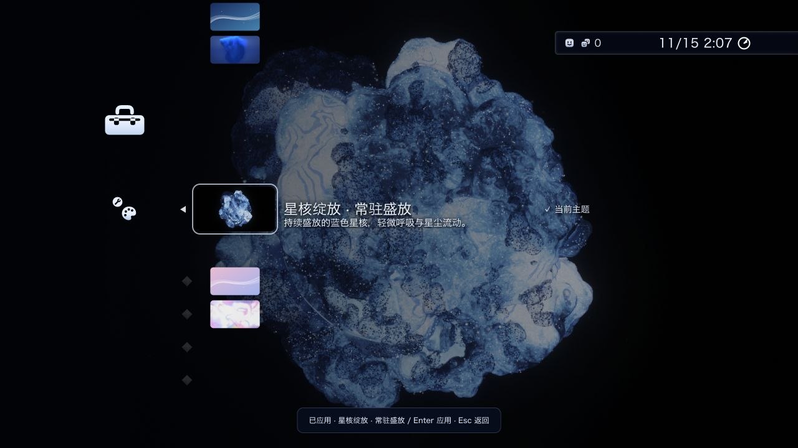
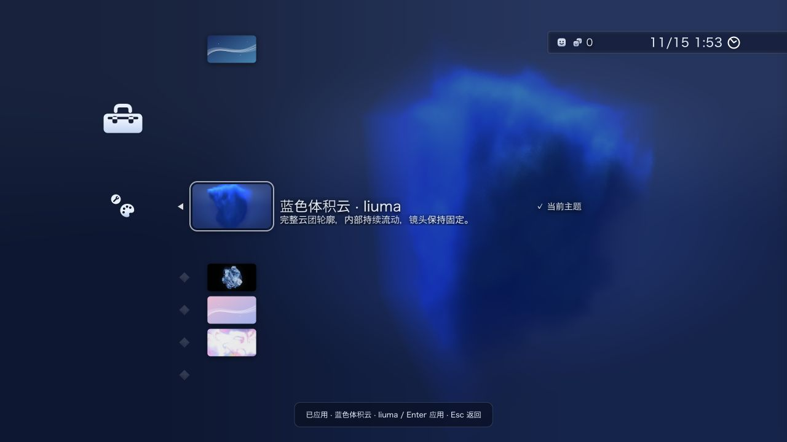
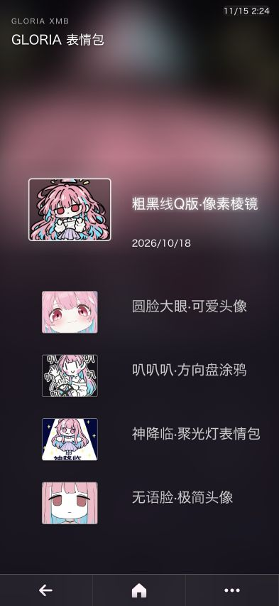
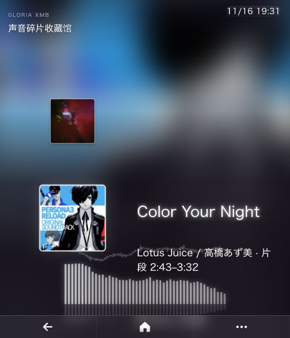

<div align="center">

<a href="https://www.bilibili.com/toy/gloria-xmb/index.html"></a>

# GLORIA XMB

**做在浏览器里的 XMB 风格个人创作启动器，放着 GLORIA 的图、短片、B 站投稿和常听的歌。**<br>
<sub>次世代 B 站启动器 · 光彩跃然 · v2.1.0 · <a href="README.md">English</a></sub>

<a href="https://www.bilibili.com/toy/gloria-xmb/index.html"></a>
<a href="README.md"></a>
<a href="CHANGELOG.md"></a>

<a href="https://github.com/seasnakes/gloria-xmb/stargazers"></a>
<a href="https://x.com/snakeseas"></a>
<a href="https://space.bilibili.com/486682682"></a>
<a href="https://www.zhihu.com/people/SeASnAkE"></a>

</div>

<a href="https://www.bilibili.com/toy/gloria-xmb/index.html"></a>

## 这是什么

GLORIA XMB 是一个运行在浏览器里的十字媒体菜单（XMB）风格个人创作启动器，直接部署在[哔哩哔哩 Toy](https://www.bilibili.com/toy/gloria-xmb/index.html) 上。

我用它把围绕原创角色 **GLORIA（光彩跃然）** 做的作品收在一处：带提示词的表情和插画、穿梭不同游戏世界的短片、B 站视频投稿、喜欢的音乐片段，以及之前做过的几个网页小工具。

界面支持简体中文和英文切换（`设定 → 系统设定 → 系统语言`）。它只是网页端的界面复刻与作品合集，不是真正的操作系统，也不是 Sony 或 PlayStation 的官方产品。

## 动态主题

<table><tr>
<td width="50%" valign="top"><a href="https://www.bilibili.com/toy/gloria-xmb/index.html"></a><br><b>星核绽放 · 常驻盛放</b><br><sub>持续盛放的蓝色星核，保留星尘与表面细节流动，不会反复坍缩重播。</sub></td>
<td width="50%" valign="top"><a href="https://www.bilibili.com/toy/gloria-xmb/index.html"></a><br><b>蓝色体积云 · liuma</b><br><sub>保留完整的云团轮廓，内部云层密度与光照持续流动，镜头固定不旋转。</sub></td>
</tr></table>

在 `设定 → 主题设定 → 主题` 里可以切换背景主题：

- **棉花糖 · 光彩跃然**（顶图默认主题）：粉彩流体循环背景，亮度会随黎明、白天、黄昏、夜晚自动或手动变化。
- **星核绽放 · 常驻盛放**：实时 WebGL2 星核视效，停在完全展开的形态，细节与星尘持续流动，不会每隔几秒收回重来。
- **蓝色体积云 · liuma**：实时体积云渲染，完整呈现云团外形，内部云雾与光照随时间流动，视角保持固定。
- 同时保留经典的波浪与配色主题（按月份换色的**原版**主题，以及**光彩跃然**粉紫配色主题）。

在主题封面列表里停留即可直接预览动态背景；按确认会保存设置并直接返回主界面，按返回离开则会取消预览、恢复原本保存的主题。

切到浏览器后台、打开作品查看器或停留在其他作品预览时，动态背景会自动暂停；支持系统的「减少动态效果」（`prefers-reduced-motion`），当设备不支持对应 WebGL2 特性时会自动回退到备用背景。实时着色器主题的实际帧率仍取决于设备显卡性能。

## 照片、投稿与声音碎片

<table><tr>
<td width="50%" valign="top"><div align="center"><a href="https://www.bilibili.com/toy/gloria-xmb/index.html"></a></div><br><b>GLORIA 照片与提示词</b><br><sub>6 个表情作品（含循环摇摆 GIF）与 7 张风格图，每张都留着生成提示词。</sub></td>
<td width="50%" valign="top"><div align="center"><a href="https://www.bilibili.com/toy/gloria-xmb/index.html"></a></div><br><b>声音碎片收藏馆</b><br><sub>启动器内可直接播放的音乐片段，含《Color Your Night》原曲 2:43–3:32 的 49 秒截取。</sub></td>
</tr></table>

- **照片**：整理了 13 件 GLORIA 作品，分为「GLORIA 表情包」（6 件，含动态摇摆 GIF）和「GLORIA 风格图」（7 张）。点开图片可以查看或一键复制原始生成提示词，也可以直接幻灯片放映。
- **游戏**：10 段 GLORIA 穿梭不同游戏世界的 8 秒视频短片（《饥荒》《人森 · 梦想生活》《底特律：变人》《女神异闻录 5》《传说之下》《弹丸论破》《我的世界》《纪念碑谷》《重力异想世界》《合金装备》）。焦点停留会播放小窗预览，点开播放完整短片——它们是角色跨世界动画短片，不是完整可玩的游戏。早期的交互网页小工具收在 `网络 → 创作工具`。
- **视频**：「我的投稿」收录从《Opus5.5 一句话生成 world.execute(me); mv》那一期起（含该期）共 25 条当前可公开读取的 B 站投稿，可在启动器内直接观看，也能跳转 B 站原页面。
- **音乐**：「光彩跃然 GLORIA」网易云歌单之外，单独设有「声音碎片收藏馆」，目前放着《宿醉》与《Color Your Night》——后者截取自原曲 `2:43–3:32` 的 49 秒片段，在启动器内直接播放并配有频谱动画。外链歌单和外部视频能否直接播放取决于网易云音乐与 B 站当时的接口状态；不支持外链播放的曲目会引导跳转原平台收听。

## 怎么操作

- **键盘**：方向键（或 `W` `A` `S` `D`）切换分类与条目，`Enter` / `Space` / `X` 确认，`Esc` / `Backspace` / `O` 返回，`T` / `I` 打开选项菜单。看照片时按 `↑` 显示或隐藏提示词。
- **鼠标 / 触控板**：点击聚焦或打开，上下 / 左右滚动切换菜单，右键打开选项菜单。
- **手机触屏**：竖屏默认进入移动版分类主页，点选或滑动浏览；底部常驻返回、主页和选项按钮，点主页可一键回到分类主页。
- **手柄**：支持浏览器标准 Gamepad 映射，十字键或左摇杆移动，`✕` 确认、`○` 返回、`△` 选项。

## 本地跑起来

需要 Node.js（含 `npm`）和 Python 3。

```bash
npm ci
```

```bash
npm run build
```

```bash
python3 tools/serve.py
```

然后打开 http://127.0.0.1:8876/package/ 。

`npm run build` 会执行 `build_release.py`，输出发布目录 `package/` 和压缩包 `gloria-xmb-cotton-v2.zip`，同时检查脚本语法和全部本地资源引用。`tools/serve.py` 禁用了浏览器缓存并支持 HTTP `Range` 请求，方便本地预览时音视频正常跳转定位。

仓库已经跟踪了网页运行所需的压缩媒体，检出后直接构建即可，不需要原始母版影片；只有从头重新压制媒体时才需要本机原始素材。

## 源码结构

日常修改只动 `source/` 目录，`package/` 和 `gloria-xmb-cotton-v2.zip` 都是构建产物：

- `source/index.html`、`source/js/`、`source/css/`：XMB 菜单布局、输入导航、查看器、后台音乐播放器与动态主题生命周期。
- `source/content/data.js` 与 `source/plugins/gloria-content.js`：各栏目内容数据，以及把内容挂载到菜单上的插件。
- `source/themes/` 与 `source/plugins/plugins.js`：配色主题、独立 WebGL2 视效页面（`source/themes/effects/`）及启动加载清单。

`tools/` 下用于同步投稿、刷新歌单和重压媒体的维护脚本说明见 [docs/MAINTAINING.md](docs/MAINTAINING.md)。

## 更新记录

- **v2.1.0 · 2026-11-17** · 新增「星核绽放 · 常驻盛放」与「蓝色体积云 · liuma」实时视效主题，支持主题封面停留预览与确认后一键返回主页；整理 13 件 GLORIA 照片作品与 25 条公开 B 站投稿；音乐片段更名为「声音碎片收藏馆」，加入 49 秒《Color Your Night》片段。

完整记录见 [CHANGELOG.md](CHANGELOG.md)。

## 来源与署名

- **蓝色体积云 · liuma** 改自我的 Shadertoy 作品 [liuma test](https://www.shadertoy.com/view/t3sXW8)，上游原作是 tmst 的 [Volumetric lighting](https://www.shadertoy.com/view/tdjBR1)。**星核绽放**与**棉花糖**流体来自我自己的视觉实验。适配说明见 [`source/themes/effects/CREDITS.txt`](source/themes/effects/CREDITS.txt)。
- 十字菜单界面致敬经典的 XMB 交互设计。本项目是个人非官方网页作品，与 Sony Interactive Entertainment / PlayStation 无关。
- 音乐曲目、专辑封面，以及跨世界短片中致敬的游戏作品与角色均归各自权利方所有。
- **GLORIA（光彩跃然）** 角色设定、原创插画与 SEASNAKE 三角字标为个人资产。本仓库未附带开源许可证；公开源码仅供浏览与参考，不授予代码、角色视觉资产或第三方素材的再分发与商用许可。

## Star History

<a href="https://www.star-history.com/#seasnakes/gloria-xmb&Date">
 <picture>
   <source media="(prefers-color-scheme: dark)" srcset="https://api.star-history.com/svg?repos=seasnakes/gloria-xmb&type=Date&theme=dark" />
   <source media="(prefers-color-scheme: light)" srcset="https://api.star-history.com/svg?repos=seasnakes/gloria-xmb&type=Date" />
   
 </picture>
</a>

<div align="center">
<br>
<sub>by SEASNAKE · <a href="https://x.com/snakeseas">X</a> · <a href="https://space.bilibili.com/486682682">B站</a> · <a href="https://www.zhihu.com/people/SeASnAkE">知乎</a> · <a href="README.md">English</a></sub>
</div>
